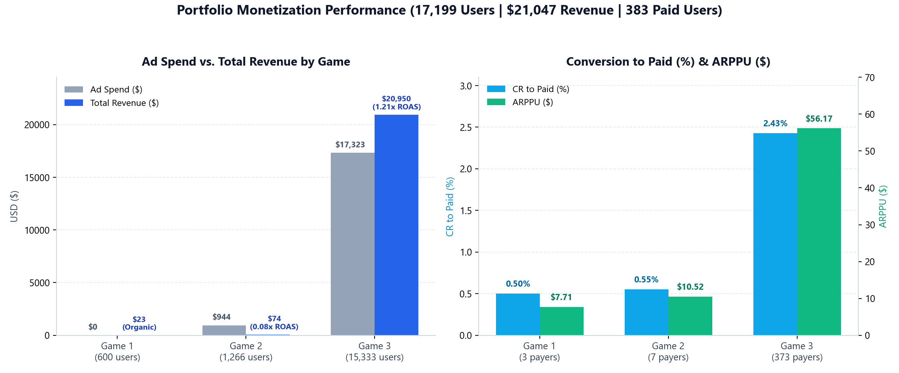
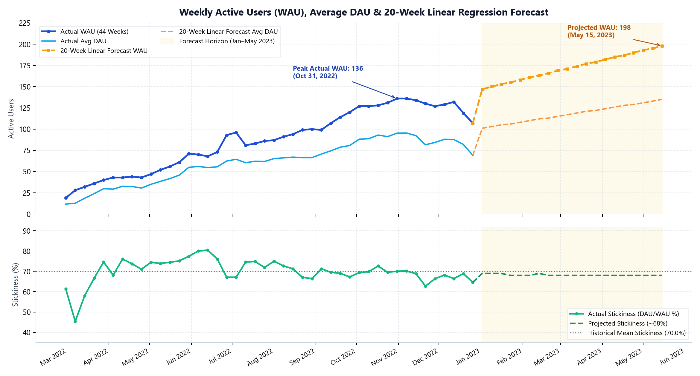
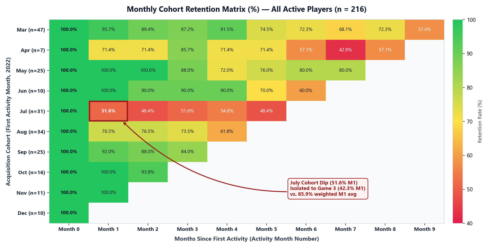
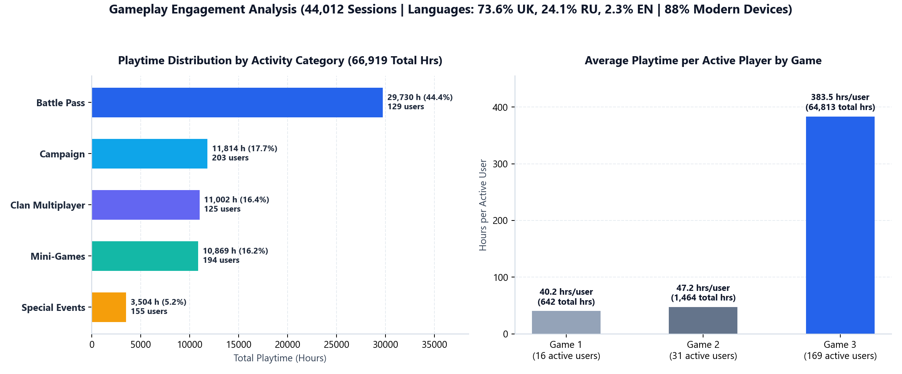

# Mobile Gaming Portfolio Analytics — Monetization, Engagement Forecasting & Cohort Retention Case Study

> **Tools:** Google Sheets (`SUMIF`, `COUNTIF`, `AVERAGEIF`, `MINIFS`/`MAXIFS`, `COUNTUNIQUEIFS`, `PERCENTILE`, `STDEV`, `FORECAST`, `SPLIT`, `VLOOKUP`, `DATEDIF`, Pivot Tables, Conditional Formatting Color Scales, Multi-Slicers)  
> **Scope:** Cross-title product performance across 3 mobile games (`Game 1`, `Game 2`, `Game 3`) spanning monetization telemetry (`17,199` users, `3,029` payment transactions) and granular gameplay logs (`216` active players, `44,012` activity sessions, `66,919` playtime hours, Mar–Dec 2022 + 20-week 2023 projection).

---

## 1. Executive Summary

This case study evaluates **monetization efficiency**, **player habit formation**, **future active-user trajectory**, and **monthly cohort retention** across a three-title mobile gaming portfolio built entirely in Google Sheets.

### Key Findings at a Glance
- **Revenue & Conversion Concentration:** **Game 3** generated **$20,950.15** (**99.5%** of total portfolio revenue of **$21,046.89**), achieving a **2.43% Conversion-to-Paid (CR)** and **$56.17 ARPPU** — outperforming Game 1 (`0.50% CR`, `$7.71 ARPPU`) and Game 2 (`0.55% CR`, `$10.52 ARPPU`) by **4.4x–4.9x in conversion** and **5.3x–7.3x in revenue per payer**, yielding **1.21x ROAS** vs. **0.08x ROAS** on Game 2.
- **Playtime Validates Monetization Gap:** Across `44,012` session logs, **Game 3** players logged **383.5 hours per active player** (nearly **8x–9.5x** higher than Game 2's `47.2 hrs/player` and Game 1's `40.2 hrs/player`), with **Battle Pass** (`29,730 hrs`, **44.4%** of all gameplay time) acting as the strongest long-session retention anchor.
- **Strong Habit Formation & Growth Trajectory:** Weekly Active Users (WAU) scaled from `19` (`Feb 28, 2022`) to a peak of **`136`** (`Oct 31, 2022`), while **Stickiness (`DAU / WAU`) averaged `70.0%`** (peaking at **`80.5%`** in June 2022). A 20-week linear regression model projects WAU reaching **`198`** and Average DAU reaching **`135`** by mid-May 2023 (~`68%` stickiness).
- **Cohort Retention & July Anomaly Diagnosis:** Weighted Month-1 retention across all observable cohorts averaged **`85.9%`**, and the March acquisition cohort maintained **`57.4%`** retention through Month 9. However, the **July 2022 cohort (`n = 31`)** experienced a sharp Month-1 drop to **`51.6%`**, isolated via segment analysis to **Game 3's July intake (`42.3%` M1 retention, `11/26` retained)**.

---

## 2. Business Questions & Data Architecture

| Module | Analytical Objective | Relational Entities & Join Keys |
| :--- | :--- | :--- |
| **Part 1: Monetization & Unit Economics** | Measure acquisition ROI, conversion funnel, payer value (ARPPU), and payer age profile across titles | `games` ↔ `games_payments` ↔ `games_paid_users` *(joined via `game_name` and `user_id`)* |
| **Part 2: Engagement & Variability** | Quantify age distribution spread and compute daily/weekly habit metrics (`DAU`, `WAU`, `DAU/WAU`) | `active_users` ↔ `activity` → aggregated into daily (`dau`) and weekly (`wau`) time series |
| **Part 3: Forecasting & Cohort Retention** | Project 20-week user growth via linear regression, classify gameplay modes, and build interactive cohort retention matrices | Enriched `activity` (`SPLIT`, `VLOOKUP`, `MINIFS`, `DATEDIF`) → `Pivot table` + Slicers |

*(Note: Raw course dataset tables are intentionally excluded from this repository in accordance with portfolio best practices; all metrics, schema definitions, formula architectures, and charts reflect verified analytical outputs.)*

---

## 3. Part 1 — Monetization & Unit Economics Analysis

### Game-Level & Blended Portfolio KPIs

| Game | Ad Spend | Total Users | Paid Users | CR to Paid (%) | Total Revenue | ARPPU | Paid Age (Avg / Med / Range) | ROAS |
| :--- | :---: | :---: | :---: | :---: | :---: | :---: | :---: | :---: |
| **Game 1** | $0.00 | 600 | 3 | 0.50% | $23.13 | $7.71 | 22.3 / 21 / 20–26 | Organic |
| **Game 2** | $944.33 | 1,266 | 7 | 0.55% | $73.61 | $10.52 | 25.0 / 21 / 18–35 | 0.08x |
| **Game 3** | $17,322.71 | 15,333 | 373 | **2.43%** | **$20,950.15** | **$56.17** | 23.2 / 22 / 14–44 | **1.21x** |
| **Portfolio Total / Blended** | **$18,267.04** | **17,199** | **383** | **2.23%** | **$21,046.89** | **$54.95** | — | **1.15x** |

> **Analytical Note on Aggregation:** Portfolio-level `CR to Paid (2.23%)` and `ARPPU ($54.95)` are computed from portfolio totals (`383 / 17,199` and `$21,046.89 / 383`) rather than summing per-game rates, avoiding rate-summation distortion.

### Key Diagnostic Insights (Part 1)
1. **Repeat Purchase Velocity:** Game 3's `$20,950.15` revenue stems from `3,008` payment events across `373` payers (**`8.06` transactions per payer**, averaging **`$6.96`** per transaction), indicating strong recurring in-app purchase loops rather than one-off conversions.
2. **Acquisition & Store Hypothesis:** Game 1 (`$0` ad spend) and Game 2 (`0.08x ROAS`) suffer from sub-1% conversion (`0.50%–0.55%`) and low ARPPU (`$7.71–$10.52`), pointing toward insufficient top-of-funnel volume/targeting and uncompelling store offers.

---

## 4. Part 2 — Engagement, Distribution Variability & 20-Week Forecast

### Active User Demographics & Age Variability (`n = 216`)
- **Age Distribution:** Mean **`28.01`** yrs | Standard Deviation **`11.28`** | Median **`25`** yrs | Interquartile Range (**IQR**) **`15`** yrs | 10th Percentile **`17`** yrs | Range **`14–83`** yrs. Because the mean exceeds the median (`28.01 > 25`) with a wide spread (`SD = 11.28`), median and IQR provide a truer representation of the core player demographic than mean alone.
- **Locale & Hardware:** **`uk` (`73.6%`, 159 users)**, **`ru` (`24.1%`, 52 users)**, **`en` (`2.3%`, 5 users)**; **`88.0%`** (`190/216`) operate modern devices vs. **`12.0%`** (`26/216`) on legacy hardware.

### Daily/Weekly Engagement & Regression Forecast
- **Actual Performance (44 Weeks, Mar–Dec 2022):**
  - **DAU (`306` days):** Min `9` | Mean **`61.22`** | Max **`109`**.
  - **WAU (`44` weeks):** Scaled from `19` (`Feb 28, 2022`) to a peak of **`136`** (`Oct 31, 2022`), averaging **`87.2` WAU**, with a modest late-December holiday dip (`107`).
  - **Stickiness (`DAU / WAU`):** Averaged **`70.0%`** across the year (`45.4%`–`80.5%`), demonstrating ~4.9 active days per weekly active user.
- **20-Week Forecast (Jan–May 2023):**
  - Modeled with absolute-locked `=ROUND(FORECAST(...), 0)` references across historical weeks `2–45`: projected WAU grows from **`147`** (`Jan 2, 2023`) to **`198`** (`May 15, 2023`), while projected Avg DAU climbs from **`101`** to **`135`** at a steady **`68%–69%`** stickiness ratio.

---

## 5. Part 3 — Activity Mix & Interactive Cohort Retention Analysis

### Cohort Retention Performance (`Mar–Dec 2022`, `Months 0–9`)
- **Weighted Retention Curve:** **M0:** `100.0%` (`216`) → **M1:** **`85.9%`** (`177/206`) → **M2:** **`81.5%`** → **M3:** **`78.2%`** → **M4:** **`73.4%`** → **M5:** **`67.5%`** → **M6:** **`71.9%`** → **M7:** **`69.6%`** → **M8:** **`70.4%`** → **M9:** **`57.4%`** (`27/47`).
- **Standout Cohort Durability:** March (`n = 47`) retained **`95.7%`** at Month 1 and **`57.4%`** after 9 months; May (`n = 25`), June (`n = 10`), October (`n = 16`), and November (`n = 11`) cohorts all achieved **`100%`** Month-1 retention.
- **Root-Cause Diagnosis — July Cohort Anomaly (`Month 7`):** July's cohort (`n = 31`) dropped sharply to **`51.6%`** Month-1 retention (`16/31`). Segmenting by title reveals that while Game 1 (`1/1`) and Game 2 (`4/4`) held 100%, **Game 3's July cohort (`n = 26`) fell to `42.3%` Month-1 retention (`11/26`)** — flagging an acquisition-quality or July patch/onboarding regression specific to Game 3.

### Gameplay Mode & Depth Breakdown (`44,012` Sessions, `66,919.4` Hours)
- **Battle Pass (`29,730.3 hrs` | `44.4%` of playtime | `129` users):** Highest time-sink mode (`230.5 hrs/user`), driving core session depth.
- **Campaign (`11,814.2 hrs` | `17.7%` | `203` users):** Broadest entry-point reach (**94.0%** of active players).
- **Mini-Games (`10,868.9 hrs` | `16.2%` | `194` users)** & **Clan Multiplayer (`11,002.4 hrs` | `16.4%` | `125` users)** provide strong social and casual retention loops, while **Special Events (`3,503.6 hrs` | `5.2%` | `155` users)** support periodic spikes.
- **Interactive Filtering:** The Google Sheets `Pivot table` dashboard pairs dual gradient heatmaps (active user counts + dynamic `%` retention rates with `$` column locking and `#DIV/0!` guards) with **3 live Slicers** (`game_name`, `activity_type`, `activity_language`).

---

## 6. Actionable Business & Product Recommendations

1. **Game 2 Monetization Turnaround:** Launch **lookalike user acquisition campaigns** modeled on existing high-LTV Game 3 payers and run **A/B pricing experiments** introducing low-friction starter packs (`$0.99–$2.99`) to lift `0.55%` CR and `0.08x` ROAS.
2. **Audit Game 3's July Retention Drop:** Review July 2022 acquisition channel mix, ad creatives, and in-game onboarding updates for Game 3 to identify why M1 retention fell from `95.7%` (Mar) / `100%` (May–Jun) to `42.3%` (Jul) before recovering to `88.9%` in September.
3. **Cross-Title Engagement Loops:** Introduce Battle Pass and Clan Multiplayer progression hooks into Game 1 and Game 2, where per-player engagement (`40.2–47.2 hrs`) lags Game 3 (`383.5 hrs`) by an order of magnitude.
4. **Localization Prioritization:** Given `97.7%` of the active player base uses `uk` (`73.6%`) or `ru` (`24.1%`) locales while `en` accounts for just `2.3%`, evaluate whether English store/UI onboarding creates friction in international expansion.

---

## 7. Repository Structure

- [`README.md`](README.md) — Executive case study report, findings, and recommendations.
- [`docs/methodology_and_formulas.md`](docs/methodology_and_formulas.md) — Complete Google Sheets formula architecture, data-cleaning pipeline, pivot/slicer configuration, and engineering notes.
- [`assets/`](assets/) — Publication-grade analytical visualizations generated from verified spreadsheet calculations.
